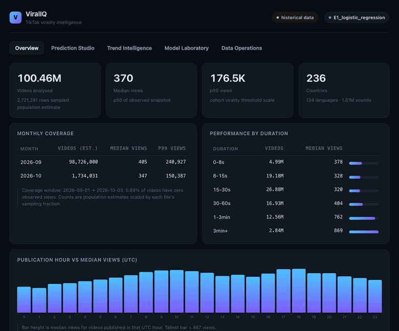
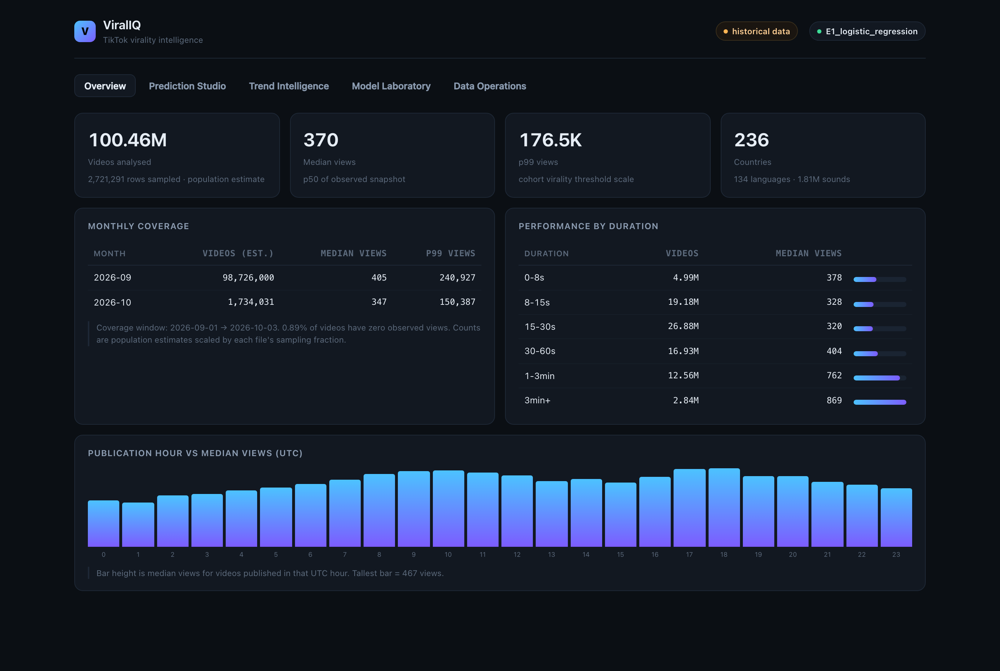
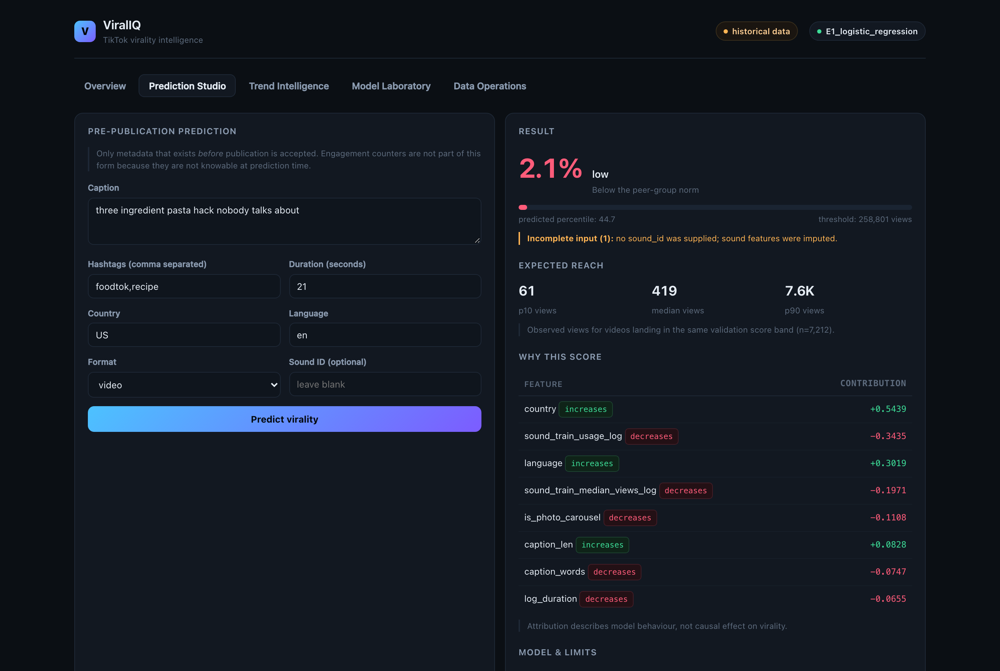
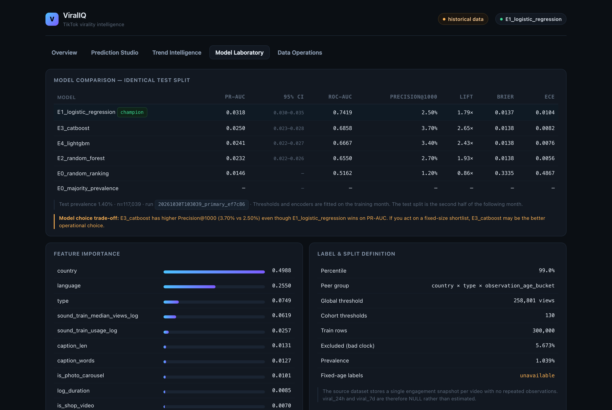
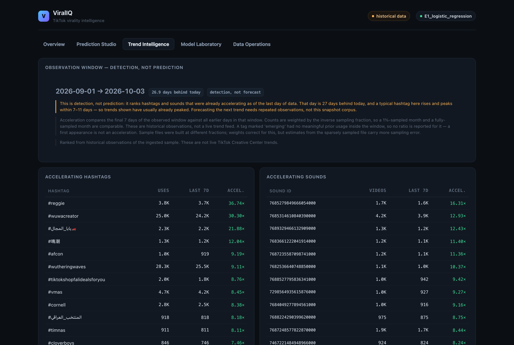
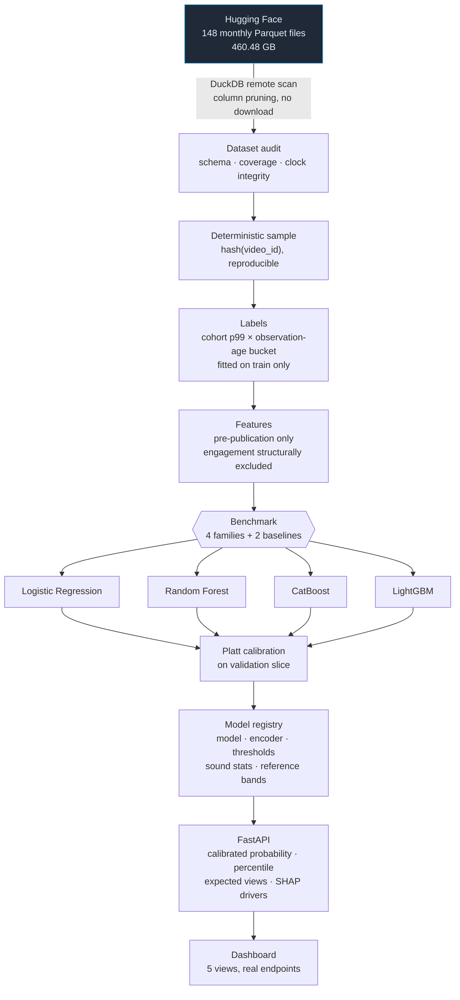

<div align="center">

# ViralIQ

**TikTok virality intelligence — predict which videos break out, explain why, and prove the predictions hold up in a later period.**

[](https://github.com/darderrdur17/ViralIQ/actions/workflows/ci.yml)
[](#verification)
[](pyproject.toml)
[](api/main.py)
[](docs/data_sources.md)
[](https://vercel-mu-ochre-19.vercel.app)
[](#honest-limitations)

**[→ Open the live dashboard](https://vercel-mu-ochre-19.vercel.app)**

</div>

---

Most TikTok virality projects train a classifier on engagement counts, report a high score, and
stop. That number is usually meaningless, because the model was shown the answer.

ViralIQ is built around the opposite discipline. It predicts virality from **metadata that exists
before a video is published**, scores itself only on **strictly later months**, and reports what it
*cannot* do as prominently as what it can. Along the way it found that the public dataset everyone
reaches for has a broken observation clock — and that a plain logistic regression beats CatBoost
on this feature set.

| | |
|---|---|
| **Prediction target** | Probability a video lands in the top 1% of observed views within its peer group |
| **Signal available at prediction time** | Caption, hashtags, duration, format, timing, language, country, commercial flags, sound history |
| **Measured performance** | PR-AUC **0.0318** vs **0.0146** random (2.18×), ROC-AUC **0.742** |
| **What it is not** | A seven-day view forecaster — the source data cannot support that claim |

---

## See it

Metadata in, calibrated score out — with expected reach and the features that drove it:



**Overview** — dataset scale, coverage, and performance by duration:



**Prediction Studio** — every score carries its expected reach, its drivers, and its limitations:



<details>
<summary><b>Model Laboratory</b> — the benchmark, the champion, and the trade-off it hides</summary>



</details>

<details>
<summary><b>Trend Intelligence</b> — detection, with the lag stated rather than hidden</summary>



</details>

---

## What actually works today

| Capability | Status |
|---|---|
| Remote dataset audit (460 GB, no full download) | Implemented, verified against the live source |
| Reproducible stratified sampling | Implemented, verified |
| Cohort-relative labelling with leakage guards | Implemented, unit-tested |
| Chronological train / validation / test split | Implemented, unit-tested |
| CatBoost / LightGBM / Random Forest / Logistic Regression benchmark | Implemented, executed |
| Calibrated probabilities, percentile, expected view range | Implemented |
| SHAP attribution, tree **and** linear models | Implemented |
| FastAPI inference + persistence | Implemented, tested |
| Dashboard wired to real endpoints | Implemented, browser-verified |
| Data freshness / operating-mode reporting | Implemented |
| Trend detection (accelerating hashtags and sounds) | Implemented — retrospective, with the measured lag disclosed |
| Next-trend **forecasting** | **Not possible** with this dataset — [measured evidence](reports/research/trend_forecast_feasibility.md) |
| Early-traction prediction (velocity) | **Blocked** — needs repeated observations |
| Multimodal (video / audio) features | **Not implemented** — no media in the source |
| Live TikTok ingestion | **Not implemented** — requires approved API access |

Where a capability is missing, the API says so (`409`, `503`, or `available: false`) instead of
approximating. The trend panel reports detection with a measured ~27-day lag rather than implying
a forecast.

---

## Contents

- [See it](#see-it)
- [What actually works today](#what-actually-works-today)
- [The finding that shapes everything](#the-finding-that-shapes-everything)
- [Measured results](#measured-results)
- [How it works](#how-it-works)
- [Why the label is not "250,000 views"](#why-the-label-is-not-250000-views)
- [Five things worth knowing](#five-things-worth-knowing)
- [Quick start](#quick-start)
- [API](#api)
- [Leakage controls](#leakage-controls)
- [Repository map](#repository-map)
- [Verification](#verification)
- [Honest limitations](#honest-limitations)
- [Deployment](#deployment)
- [Resources](#resources)

---

## The finding that shapes everything

The dataset ([`datasocial/tiktok-5.6B-videos`](https://huggingface.co/datasets/datasocial/tiktok-5.6B-videos),
148 monthly Parquet files, **460.48 GB**) stores one engagement snapshot per video, stamped with
`stats_updated_at`. Subtract publication time and you get the video's age when its counters were
read — the anchor every "views after N days" claim depends on.

I measured it instead of trusting it:

| Partition | Rows | % of rows where stats predate publication | Median observation age |
|---|---:|---:|---:|
| `2026-09` | 98,594,752 | **5.71%** | 285.7 h |
| `2026-10` | 1,734,031 | **34.72%** | 14.1 h |

A video cannot accumulate views before it exists. Those rows are not noise — they are a stale
crawl batch whose counters were never refreshed, and they under-report reach (mean 4,292 views vs
9,859 for clean rows).

**Consequence:** `viral_24h` and `viral_7d` are emitted as `NULL`, not estimated. The only
defensible label is a cohort-relative snapshot label, and it is named that way in the schema, the
API, the dashboard, and the reports. Full evidence in
[`reports/research/dataset_audit.md`](reports/research/dataset_audit.md).

> This is the difference between a portfolio project and a credible one. The interesting result
> is not a higher score — it is knowing precisely which question the data can answer.

---

## Measured results

Run `20261030T122402_primary_75992a`. **Train** = 2026-09 (300,000 rows). **Test** = 2026-10
(199,998 rows), a later month never seen during fitting, calibration, or threshold selection.

| Model | PR-AUC | 95% CI | ROC-AUC | Precision@1000 | Lift@1000 | Brier |
|---|---:|---|---:|---:|---:|---:|
| **E1 Logistic regression** | **0.0318** | 0.0298–0.0350 | **0.742** | 2.50% | 1.79× | 0.0137 |
| E3 CatBoost | 0.0250 | 0.0230–0.0279 | 0.686 | **3.70%** | **2.65×** | 0.0138 |
| E4 LightGBM | 0.0241 | 0.0225–0.0265 | 0.667 | 3.40% | 2.43× | 0.0138 |
| E2 Random forest | 0.0232 | 0.0218–0.0258 | 0.655 | 2.70% | 1.93× | 0.0138 |
| E0b *heuristic:* sound popularity | 0.0152 | — | 0.514 | 1.30% | 0.93× | — |
| E0 *baseline:* random ranking | 0.0146 | — | 0.516 | 1.20% | 0.86× | 0.3335 |
| E0c *heuristic:* duration only | 0.0111 | — | 0.419 | 0.60% | 0.43× | — |

Beating random proves little, so the benchmark includes the heuristic a sceptical reader would
propose first: **rank every video by its sound's historical popularity**. Since sound features
dominate the tree importances, that is the baseline that matters — and the champion clears it by
**2.09×** (0.0318 vs 0.0152), lifting ROC-AUC from 0.514 to 0.742.

Base rate **1.40%**. Intervals are 95% percentile bootstrap clustered by `sound_id`, because
videos sharing a sound are not independent observations. `E0*` rows are baselines and heuristics:
scored on identical rows, and never eligible to be champion — a heuristic that outscored the models
would otherwise have been shipped, so `tests/test_champion_selection.py` pins that rule.

**How to read this honestly**

- PR-AUC 0.0318 against a 0.0146 baseline is **2.18× random**. ROC-AUC 0.742 is real, but modest.
  This is a ranking prior for triage, not an oracle.
- The champion is selected on PR-AUC, but **CatBoost wins at the operating cutoff** (3.70% vs
  2.50% Precision@1000). If you act on a fixed-size shortlist, CatBoost is the better pick. The API
  returns a `selection_note` saying so rather than letting the UI imply one model is best at
  everything.
- Probabilities over-predict in absolute terms (~1.78× the observed rate). They rank well; they are
  not literal risk percentages.

---

## How it works



**Split protocol** — chronological, never random:

```
train  = month M          thresholds, encoder vocabulary, sound stats all fitted here
val    = first half M+1   calibration only
test   = second half M+1  reported performance
recent = month M+2        untouched forward-time holdout (when 3+ months ingested)
```

Random splitting would let the model learn from videos published after the ones it is scored on.
It is not offered as an option anywhere in the codebase.

---

## Why the label is not "250,000 views"

Measured p99 view counts are **152,250** (2026-10) and **246,407** (2026-09), with a median near
**350–400**. A global threshold would label almost nothing viral in small markets and almost
everything viral in large ones.

The peer group is `country × type × observation_age_bucket`.

The age bucket is the non-obvious part. A video whose counters were read 3 hours after publication
cannot be fairly compared with one read 20 days after. Two bad options present themselves: discard
most of the corpus, or compare them naively. Making age part of the definition instead cut the
exclusion rate from **71.5% → 5.7%** while keeping the comparison meaningful.

Thresholds are fitted on the training window and frozen before validation or test is touched.
Cohorts under 200 videos fall back to the global p99 (258,801 views in this run).

---

## Six things worth knowing

**1. A linear model beat three gradient boosters.** CatBoost was the expected primary candidate.
On metadata-only features it scored 0.0250 against logistic regression's 0.0318. Extra capacity
did not pay for itself — which is exactly why the champion is chosen by evaluation rather than
assumption.

**2. Sound history is the strongest signal, and that is a concentration risk.** Top features for
the champion: `country` (0.499), `language` (0.255), `type` (0.075), `sound_train_median_views_log`
(0.062). Sound statistics are frozen at the training window, so they decay as trends move.

**3. Isotonic calibration silently destroyed ranking resolution.** On a 1.4% base rate, isotonic
regression fits a step function whose plateaus map wide score ranges to one probability — distinct
videos returned *identical* numbers. Platt scaling is strictly monotonic and fixed it.

**4. Mixing sample fractions fabricated a trend.** A 1%-sampled month next to a fully-sampled one
made raw counts incomparable: hashtags appeared to accelerate 1,595×. That was the sampling
difference, not growth. Counts are now weighted by inverse sampling probability.

**5. The observation clock bounds how far back training can reach.** Adding 2026-08 as a third
month should have enabled the forward holdout. Instead it broke the label: August's median
observation age is **756 h** against a 720 h validity window, so **53%** of it is discarded, and the
survivors are a biased subsample. The fitted p99 collapsed from 258,801 to 58,526 views and test
prevalence inflated from 1.4% to 4.3% — CatBoost ended up scoring *below* random. The holdout path
works; the data cannot populate it. Full write-up in
[`reports/research/three_month_drift_experiment.md`](reports/research/three_month_drift_experiment.md).

**6. A missing sound is not an obscure sound.** Treating an absent `sound_id` as `0` usage told the
model "extremely obscure sound", inflating scores. It is now `NULL` and imputed with the training
median — which improved the champion's PR-AUC from 0.0265 to 0.0318.

---

## Quick start

> The repository is **private** — you need access before the clone below will work.
> Everything else in this section runs without any credentials.

```bash
git clone https://github.com/darderrdur17/ViralIQ.git
cd ViralIQ
python3 -m pip install -r requirements.txt
```

### Try it in 30 seconds

No download, no credentials. A committed 20,000-row fixture seeds a working dataset and model:

```bash
python scripts/seed_demo.py          # ~12s
uvicorn api.main:app --port 8000
# open http://localhost:8000/app/
```

The fixture is **real data**, not synthetic — see [`data/fixtures/README.md`](data/fixtures/README.md)
for provenance. Numbers from it are *not* the figures quoted above; those come from a 300,000-row
training window across three months.

### Full pipeline

```bash
# 1. Audit the source (remote DuckDB queries; nothing 460 GB is downloaded)
python3 scripts/audit.py --tail 2
#    → reports/research/dataset_audit.md

# 2. Build a reproducible sample (deterministic hash of video_id)
python3 scripts/build_sample.py --months 2026-09 --fraction 0.01 --name s
python3 scripts/build_sample.py --months 2026-10 --fraction 1.0  --name r

# 3. Train, calibrate, benchmark, and generate reports
python3 scripts/train.py --max-rows 300000
#    → reports/evaluation/model_benchmark.md
#    → reports/executive/executive_summary.md
#    → docs/model_card.md

# 4. Serve
uvicorn api.main:app --port 8000
#    Dashboard  http://localhost:8000/app/
#    API docs   http://localhost:8000/docs
```

Optional analyses:

```bash
python scripts/threshold_sweep.py    # how sensitive is the result to the "top 1%" line?
```

No credentials required. `scripts/train.py` defaults to `--max-rows 300000` to bound memory on a
single machine; raise it if you have the RAM.

---

## API

All routes are prefixed `/api/v1`.

| Method | Route | Purpose |
|---|---|---|
| `POST` | `/predictions/prepublish` | Score a video from metadata only |
| `POST` | `/predictions/early-traction` | Velocity-based score — **409** until observations exist |
| `GET` | `/predictions/history` | Stored predictions with the payload that produced them |
| `GET` | `/analytics/overview` | Dataset scale, coverage, view distribution |
| `GET` | `/analytics/content` | Duration, publication-hour and country breakdowns |
| `GET` | `/trends` | Accelerating hashtags and sounds (weighted) |
| `GET` | `/models` | Training runs and the active model |
| `GET` | `/models/evaluation` | Side-by-side benchmark on identical splits |
| `GET` | `/data/status` | Freshness mode, quality flags, model recency |
| `POST` | `/data/import` · `/data/upload` | Import Parquet/CSV (normalised, never overwrites) |
| `GET` | `/health` · `/meta` | Liveness, data mode, declared capabilities |

```bash
curl -s localhost:8000/api/v1/predictions/prepublish \
  -H 'Content-Type: application/json' \
  -d '{"caption":"three ingredient pasta hack","hashtags":["foodtok"],
       "duration_ms":21000,"country":"US","language":"en"}'
```

```json
{
  "viral_probability": 0.0214,
  "virality_tier": "low",
  "predicted_percentile": 44.6,
  "expected_views": { "p10": 61, "p50": 418, "p90": 7600 },
  "label_definition": "Top 1% of observed views within the same country × type × observation age bucket peer group, at snapshot time.",
  "input_warnings": [],
  "drivers": { "method": "shap_linear_aggregated", "top": [ ... ] },
  "limitations": [ ... ]
}
```

`extra="forbid"` means sending `views` returns **422** rather than being silently ignored — the
pre-publication contract is enforced by the schema, not by convention.

---

## Leakage controls

Every one of these is enforced in code, not left to discipline.

| Risk | Control |
|---|---|
| Engagement used as a pre-publication feature | Request schema has no such field; `assert_no_performance_features` raises on any feature frame containing a performance column |
| Threshold fitted on test data | Fitted on the training month, frozen in `thresholds.json`, applied unchanged |
| Sound popularity reflecting future usage | `fit_sound_stats` runs on the training window only and ships with the model |
| Category vocabulary fitted on test | Encoder sees training rows only; unseen values map to `__unseen__` |
| Random split inflating scores | Splits are strictly chronological; no random-split option exists |
| Correlated rows shrinking intervals | Bootstrap resamples whole sounds, not rows |
| Silent import of malformed data | CSV/Parquet normalised and validated before it can join the corpus |

---

## Repository map

```
src/ingestion/          Hugging Face connector · DuckDB engine · sample builder · importer
src/preprocessing/      schema validation · observation-clock integrity checks
src/labeling/           cohort thresholds · label engineering · leakage guard
src/feature_engineering/ pre-publication and early-traction feature sets
src/models/             encoder · reference distributions · training orchestration
src/evaluation/         ranking metrics · calibration · clustered bootstrap · report rendering
src/explainability/     SHAP attribution shared by training and serving
src/inference/          predictor · professional prediction object
src/monitoring/         freshness classification · model recency
api/                    FastAPI app · routes · schemas · DuckDB persistence
dashboard/              single-page analytics UI (no build step)
docs/                   architecture · methodology · data dictionary · model card · limitations
reports/                generated audit · benchmark · executive summary
tests/                  70 tests: labels, metrics, encoder, splits, importer, attribution, parity, store, deploy sync
deploy/vercel/          generated serverless project (portable model + pre-computed payloads)
```

---

## Verification

```bash
python3 -m pytest tests/ -q              # 70 passed
python3 -m ruff check src api scripts tests   # clean
```

Beyond unit tests:

- **Browser audit** — Playwright drives all five tabs, the prediction form, deep links, and
  API-failure states, asserting no console errors and no empty panels.
- **Concurrency** — 12 simultaneous predictions, 12/12 succeed.
- **Cold start** — model preloaded and warmed at startup; first prediction **0.22 s** (was 4.58 s).
- **Deployment parity** — the serverless surrogate matches the full model to `1e-7`, and the live
  site is exercised by the same browser checks.

---

## Honest limitations

- **Retrospective, not prospective.** The model estimates cohort-relative snapshot virality. It
  does not predict a seven-day view count, because the source has no seven-day observation.
- **No creator signal.** Follower counts are absent from the dataset and are not invented. This is
  probably the largest missing predictor.
- **No visual or audio content.** The dataset carries metadata, not media.
- **Sound features decay.** Frozen at the training window by necessity — using present-day
  popularity to score a past video would be leakage.
- **Historical-data mode.** Measured publication coverage lags the audit clock by **26.9 days**;
  the app reports this rather than presenting stale data as live.
- **One forward holdout.** Drift is tested against a single month boundary, so drift conclusions
  are provisional.
- **Single application process.** The DuckDB store holds an OS-level lock per file, so
  `uvicorn --workers N` is not supported. Horizontal scaling needs PostgreSQL.

Full list in [`docs/limitations.md`](docs/limitations.md); measured evidence in
[`reports/research/dataset_audit.md`](reports/research/dataset_audit.md).

---

## Deployment

**Local:** `uvicorn api.main:app --port 8000`

**Docker:**

```bash
docker compose up --build      # http://localhost:8000
```

Data, model artefacts and the DuckDB file are mounted volumes, never baked into the image.

### Vercel — [live](https://vercel-mu-ochre-19.vercel.app)

The full stack is **478 MB** installed (scikit-learn + SciPy + pandas + CatBoost + LightGBM +
DuckDB); Vercel's serverless limit is 250 MB. Rather than deploy a broken subset, the site runs a
different packaging of the same product:

| | Full service (local / container) | Serverless (Vercel) |
|---|---|---|
| Prediction | scikit-learn pipeline | Portable affine surrogate, NumPy only |
| Parity | — | `1e-7` vs the real model, asserted in CI |
| Analytics | Live DuckDB over the sample corpus | Pre-computed snapshot, timestamped |
| Persistence | DuckDB store | None — stated in the UI and API |
| Import / schema check | Available | `503` with an explanation |

The surrogate is derived by **probing the fitted pipeline**, not by reading sklearn's private
fitted attributes, so it survives library upgrades. `tests/test_portable.py` fails if the deployed
model ever drifts from the real one.

```bash
python scripts/export_portable.py      # regenerate data + mirror + dashboard copy
cd deploy/vercel && vercel --prod
```

Details in [`deploy/vercel/README.md`](deploy/vercel/README.md).

---

## Resources

**Data**
- [TikTok 5.6B Videos](https://huggingface.co/datasets/datasocial/tiktok-5.6B-videos) — CC BY-NC 4.0, 148 monthly Parquet partitions
- [TikTok Research API](https://developers.tiktok.com/products/research-api/) — approved researchers only
- [TikTok Display API](https://developers.tiktok.com/products/display-api/) — consenting creators' own content
- [TikTok Creative Center](https://ads.tiktok.com/business/creativecenter/) — official trend research

**Method**
- [DuckDB remote Parquet](https://duckdb.org/docs/stable/data/parquet/overview) — query 460 GB without downloading it
- [Precision-Recall is better than ROC for rare positives](https://doi.org/10.1371/journal.pone.0118432) — Saito & Rehmsmeier, 2015
- [SHAP](https://shap.readthedocs.io/) — Lundberg & Lee, 2017
- [scikit-learn probability calibration](https://scikit-learn.org/stable/modules/calibration.html)

**Related work studied** (architectural reference only, not forked)
- [`juanls1/TikTok-Virality-Predictor`](https://github.com/juanls1/TikTok-Virality-Predictor) — multimodal feature engineering
- [`casparbreloh/Virality-Prediction`](https://github.com/casparbreloh/Virality-Prediction) — PyTorch structure
- [`sanjeevnara7/DL-ViViT-Tensorflow`](https://github.com/sanjeevnara7/DL-ViViT-Tensorflow) — ViViT video transformer

**Project documents**
- [Architecture](docs/architecture.md) · [Methodology](docs/methodology.md) · [Evaluation protocol](docs/evaluation_protocol.md)
- [Data dictionary](docs/data_dictionary.md) · [Data sources](docs/data_sources.md) · [Model card](docs/model_card.md)
- [Dataset audit](reports/research/dataset_audit.md) · [Can we predict the next trend?](reports/research/trend_forecast_feasibility.md)
- [Three-month drift experiment](reports/research/three_month_drift_experiment.md) · [Threshold sweep](reports/evaluation/threshold_sweep.md)

---

## Licence and attribution

Code: see [LICENSE](LICENSE) — published as a portfolio artefact, all rights reserved, free to read
and run locally. Swap in MIT if you would rather it be reusable; that choice does not affect the
dataset's terms.

Data: the underlying dataset is **CC BY-NC 4.0** — **non-commercial only**. Commercial deployment
requires a separate licence from the dataset publisher.

No dataset rows are committed. `data/`, `models/` and the application database are gitignored.

<div align="center">
<sub>Built with DuckDB, Polars, scikit-learn, CatBoost, LightGBM, SHAP and FastAPI.</sub>
</div>
